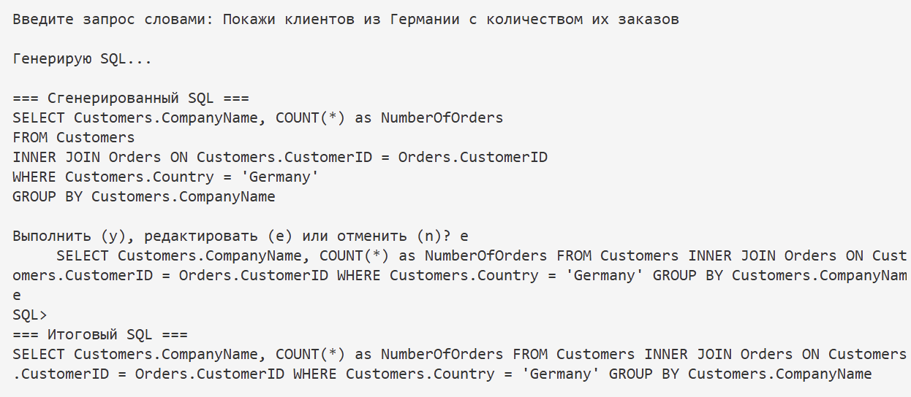
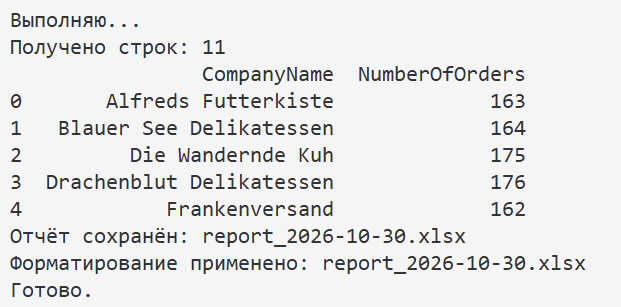
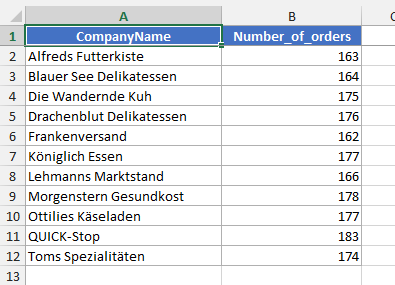

# Northwind Report Generator with AI

Интерактивный инструмент на Python, который превращает запросы на естественном языке (русский) в SQL-запросы с помощью GigaChat API, извлекает данные из базы SQLite (Northwind) и сохраняет их в отформатированный Excel-отчёт.

## Как это работает

1. Скрипт автоматически считывает структуру базы данных `northwind.db` и выводит её на экран.
2. Пользователь вводит свой вопрос обычными словами (например, «Покажи клиентов из Германии с количеством их заказов»).
3. Нейросеть (GigaChat) генерирует SQL-запрос на основе схемы базы.
4. Пользователь может проверить SQL, отредактировать его вручную или отменить выполнение.
5. Данные извлекаются через `pandas` и сохраняются в Excel с форматированием (жирные заголовки, автоширина, границы) через `openpyxl`.

## Стек технологий

- Python 3.12+
- SQLite3 — локальная база данных (Northwind).
- pandas — обработка данных и выполнение SQL.
- openpyxl — генерация и форматирование Excel-файлов.
- GigaChat API — LLM для генерации SQL (библиотека `gigachat`).

## Структура проекта

- `main.py` — точка входа, интерактивный интерфейс в терминале.
- `llm_sql.py` — логика общения с GigaChat и парсинг схемы БД.
- `report_generator.py` — сохранение DataFrame в Excel и применение стилей.
- `northwind.db` — тестовая база данных.
- `run.bat` — скрипт для удобного запуска в Windows.

## Ограничения

Поскольку SQL генерируется языковой моделью, она может ошибаться в названиях колонок или логике. Встроенный шаг подтверждения (y/e/n) позволяет проверить и исправить запрос перед выполнением.

